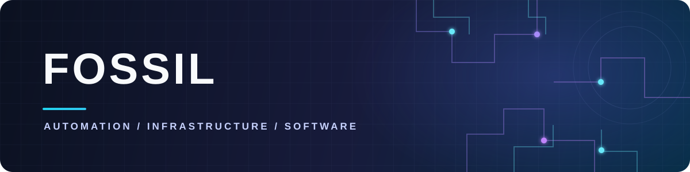

### Building useful things, from infrastructure to devices.

Embedded development with C/C++ and ESP32 is a favorite hobby, too.

## What I bring

My core toolkit is **PowerShell, Azure CLI, Python, Infrastructure as Code, and C#**. I use it to automate workflows, work with cloud infrastructure, and build practical tools. Outside that core skill set, embedded development is a favorite hobby: I enjoy building connected ESP32 devices and firmware.

| Focus | What that looks like |
|:--|:--|
| **PowerShell & Azure CLI** | Repeatable workflows, practical scripting, cloud operations, and automation |
| **Python & Infrastructure as Code** | Automation, tooling, and declarative infrastructure; public IaC examples are coming soon |
| **C#** | Application development and software tooling |
| **Embedded development (hobby)** | C/C++ firmware for ESP32 with ESP-IDF, Arduino, and PlatformIO |
| **Connected devices** | USB HID, BLE, Wi-Fi, Ethernet, OTA updates, and device interfaces |
| **Product thinking** | Prototypes developed into documented, testable projects and releases |

## Selected work

Project cards update with repository details. Each project is linked to its source.

<table>
<tbody>
<tr>
<td width="50%" align="center">

 ESP32-S3 AMOLED · LVGL · persistent virtual pet · web flasher and simulator
</td>
<td width="50%" align="center">

 ESP32 aquarium game · fish genetics · story adventures · 18 mini-games
</td>
</tr>
</tbody>
<tbody>
<tr>
<td width="50%" align="center">

 USB HID to BLE HID · multiple paired-device profiles
</td>
<td width="50%" align="center">

 Interactive ESP32-S3 hardware diagnostics · LVGL · ESP-IDF
</td>
</tr>
</tbody>
<tbody>
<tr>
<td width="50%" align="center">

 Network monitor · Wake-on-LAN and SSH · Ethernet · OTA · MQTT
</td>
<td width="50%" align="center">

 ESP32-S3 ePaper reader · EPUB · microSD · touch · web file manager
</td>
</tr>
</tbody>
<tbody>
<tr>
<td width="50%" align="center">

 Wi-Fi macro pad firmware for the Guition ESP32-S3 4-inch touchscreen
</td>
<td width="50%" align="center">

 Firmware updater application for the DragonInjector
</td>
</tr>
</tbody>
</table>

[**Explore all repositories →**](https://github.com/jeromedontdev?tab=repositories)

## Activity

### Open to interesting problems and collaborations.

[Connect on GitHub](https://github.com/jeromedontdev)

